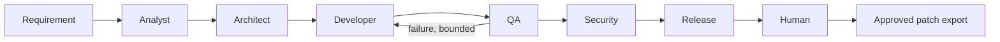

# CortexForge

**Autonomous Enterprise Engineering Organisation — Pine Labs case study**

A local engineering control room that moves a requirement through typed agents,
isolated code changes, real checks, bounded repair and explicit human review.
Live AI uses Groq with `openai/gpt-oss-120b` (see [model selection](docs/model-selection.md)). A separately labelled fixture mode makes failure handling
reproducible without purchasing model access. Neither mode invents tool results.



Read the [project scope](docs/PROJECT_SCOPE.md) and [requirements traceability](docs/traceability.md),
[architecture](docs/architecture.md), [agent contracts](docs/agent-design.md),
[state machine](docs/workflow-state-machine.md), [security model](docs/security-model.md),
[evaluation](docs/evaluation.md), [demo guide](docs/demo-guide.md),
[limitations](docs/limitations.md) and [current status](docs/IMPLEMENTATION_STATUS.md).

## Windows PowerShell setup

Prerequisites: Python 3.11+, Node 22+, Git, Docker Desktop with Linux containers
and WSL2. No deployment, cloud database or paid sandbox is required.

```powershell
python -m venv .venv
.\.venv\Scripts\Activate.ps1
python -m pip install -e '.[dev]'
Copy-Item .env.example .env
# Edit .env: set a private random REVIEW_TOKEN.
# For live mode also set GROQ_API_KEY and a model ID available to your account.
docker build -f scripts/Dockerfile.sandbox -t cortexforge-sandbox:local .
python scripts/init_sample.py
python -m uvicorn cortexforge.api:app --host 127.0.0.1 --port 8000
```

In a second terminal:

```powershell
cd apps/web
npm.cmd install
npm.cmd run dev
```

Open the printed local frontend address. Enter REVIEW_TOKEN in the interface.
Use the path printed by init_sample.py when creating a demo run. API documentation:
http://127.0.0.1:8000/docs. Runtime artifacts and local credentials are Git-ignored.

Configuration: DATABASE_URL defaults to local SQLite, MAX_REPAIR_ATTEMPTS defaults
to 3, SANDBOX_IMAGE selects the prebuilt image. Execution is Docker-only;
EXECUTION_MODE is documented as docker, with no unsafe host mode. Model overrides
and optional pricing are described in `.env.example` and agent-design.md.

For the exact verified Python dependency versions, install `requirements.lock`
before `pip install -e . --no-deps`. The lock captures the tested Windows/Python
3.12 environment; other Python/platform combinations need independent verification.
Use `npm.cmd ci` to reproduce the frontend's committed package lock.

## Verification and evaluation

```powershell
python -m pytest -q
python -m ruff check backend scripts evaluation
python evaluation/run.py
cd apps/web
npm.cmd test
npm.cmd run build
```

Docker tests skip explicitly if the engine/image is missing; a skip is not a
pass. Evaluation requires Docker and fails with a clear blocker otherwise.
Contract tests use labelled execution doubles; Docker tests run actual checks.

## Troubleshooting

- Docker unavailable: start Docker Desktop, choose Linux containers, build image.
  Planning remains available; execution pauses without host fallback.
- API 401: set REVIEW_TOKEN in `.env`, restart backend and enter the same token.
- Live provider blocked: configure key and model; inspect persisted error and
  explicitly resume. Never paste keys into requirements or source code.
- Dirty source repository: commit its intended baseline before import. The app
  imports committed content only and does not alter the supplied source.
- Missing project dependencies: extend and rebuild the curated sandbox image
  manually; agents cannot install arbitrary dependencies or access the network.
- Interrupted patch: inspect isolated files, then start a fresh run. Automatic
  replay is intentionally prohibited when completion is uncertain.

Human approval is a persisted local token-authorized decision bound to content
and evidence. It does not merge or deploy. Local Docker is a development security
boundary, not a guarantee against sophisticated hostile workloads. Tests and
static scans cannot prove arbitrary acceptance criteria or complete security.

*CortexForge is publicly available on GitHub as a locally executable case-study implementation*

## Demonstrations and audit


The screenshot is retained historical evidence, not a current live-run claim.
The original Groq discount run passed 8 unit and 12 independent acceptance tests
and was approved by the human reviewer. See `evaluation/live-results.json` and
`evaluation/final-run-audit.json` for the separate execution and decision records.

The latest live refund run passed 15 unit tests and all 20 independent cases
after two bounded repairs. It awaits a human decision. Its complete diff,
baseline, failed attempts and model usage are in
`evaluation/live-refunds-aaf4eb55a7dc400ca16873196177c72d-resume0.json`.

A second multi-file FastAPI scenario exercises idempotent refunds, strict input
validation, business rules and concurrent duplicate requests. Its baseline has
no refund endpoint. The same generic workflow implements it; 20 trusted HTTP
checks are injected into the sandbox and cannot be edited by the Developer.

```powershell
python scripts/init_sample.py --sample refund-service
python evaluation/live.py --scenario refunds --pace-seconds 62
```

Live results depend on provider quota and model output. The script prints a
unique evidence path and stops at a human checkpoint or a documented failure.
Use the matching acceptance profile in the UI for live submissions. Generic
repositories without an independent oracle require human semantic review.

For reproducible failure-and-repair demonstration, choose the payments fixture
and `test` fault. Other faults are `security`, `malformed`, `provider`, `scope`,
`repeat` and `disagree`. Failed/blocked injected runs are expected safe outcomes.
Automated fixture batches use separate runtime databases, keeping the UI's human
review history intact. Reports no longer overwrite previous evaluation evidence.

Read the [clean-clone verification](docs/FRESH_CLONE_VERIFICATION.md),
[independent audit](docs/FINAL_AUDIT.md),
[interview walkthrough](docs/INTERVIEW_DEMO.md) and
[submission readiness](docs/SUBMISSION_READINESS.md). Fresh verification counts
and remaining limitations are maintained in the audit and traceability matrix.

## Technology and authority

Python/FastAPI, Pydantic, LangGraph, SQLAlchemy/SQLite, Git worktrees and Docker
form the backend. React/TypeScript, TanStack Query and Vite form the console.
Groq drives Analyst, Architect and Developer; deterministic QA, Security and
Release specialists run tools and enforce policy. Models propose; the workflow
validates and applies; the human decides. Cancellation is cooperative and
preserves evidence. No automatic merge, push or deployment exists.
