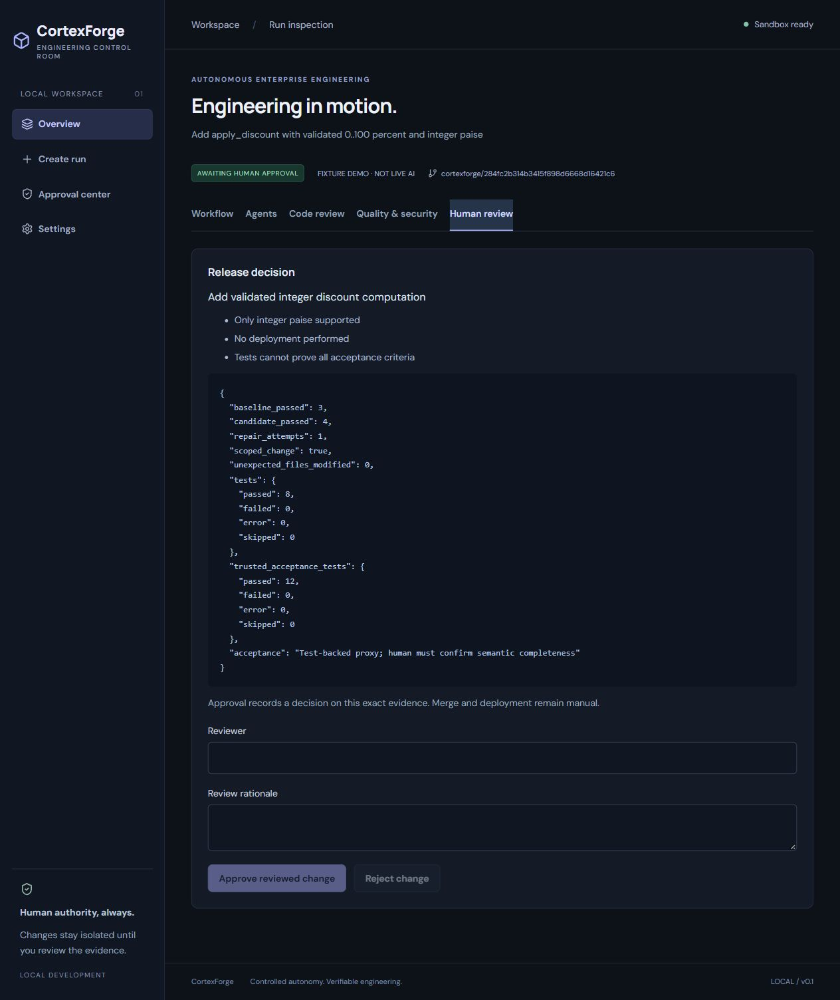
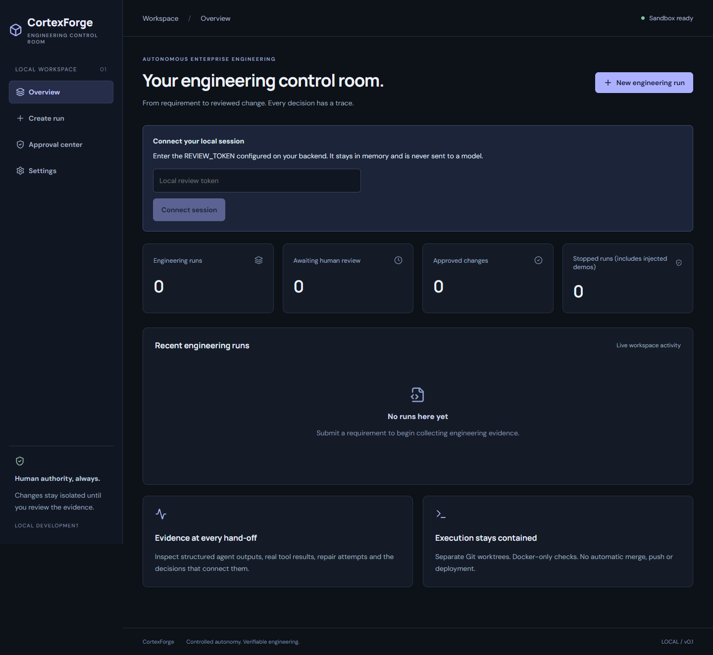
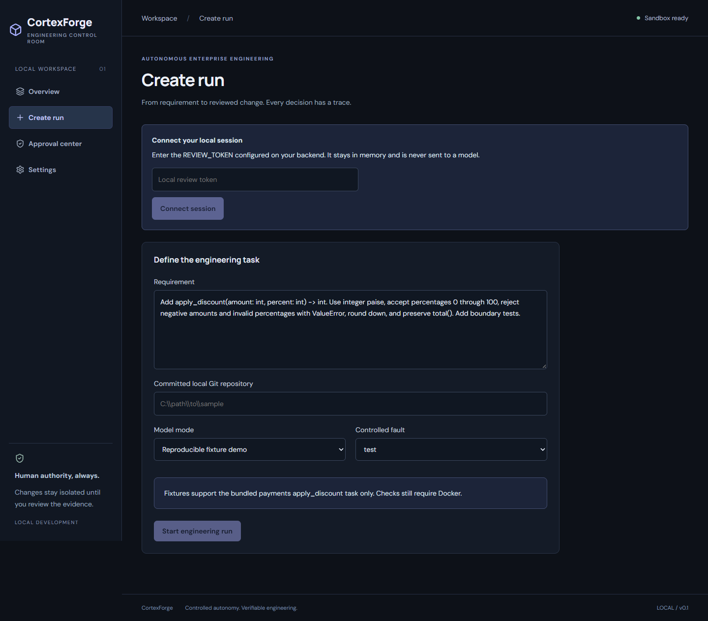
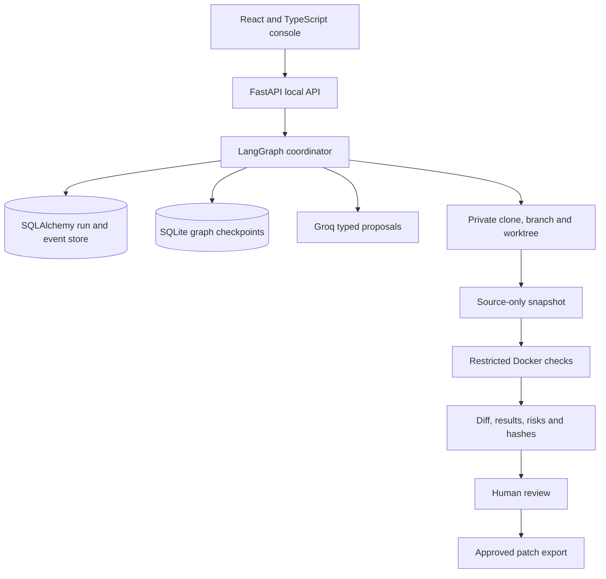
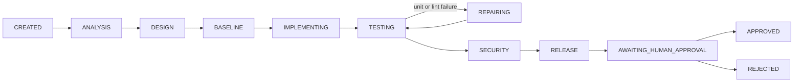

# CortexForge

### A requirement becomes a reviewed patch—with evidence at every step.

CortexForge is a locally executable engineering-agent case study built by **Pranjal Pathak** for Pine Labs PS3. It turns a requirement and a controlled Python repository into a plan, an isolated code change, real test results, security findings, and a human review checkpoint.

**Models propose. Deterministic tools verify. Humans decide.**

*CortexForge is publicly available on GitHub as a locally executable case-study implementation.*

[Source repository](https://github.com/pranjalpathak7/cortexforge) · [Traceability](docs/traceability.md) · [Clean-clone verification](docs/FRESH_CLONE_VERIFICATION.md) · [Independent audit](docs/FINAL_AUDIT.md)

| Implemented capability | What it means |
|---|---|
| Six specialist roles | Analyst, Architect, Developer, QA, Security and Release have explicit responsibilities |
| Repository isolation | Private Git clone, branch and worktree; supplied source stays unchanged |
| Executable verification | Docker runs unit tests, Ruff, Bandit and independent acceptance checks |
| Bounded recovery | Repair, schema correction, disagreement resolution and human resume have limits |
| Durable evidence | SQLite records, graph checkpoints, diffs, tool output and model metrics |
| Human authority | Content-bound approval enables patch export; no automatic merge or deployment |

## Contents

1. [See the application](#see-the-application)
2. [Choose your execution mode](#choose-your-execution-mode)
3. [Prerequisites](#prerequisites)
4. [Windows setup from a fresh clone](#windows-setup-from-a-fresh-clone)
5. [First walkthrough](#first-walkthrough)
6. [Live AI and refunds](#live-ai-and-refunds)
7. [Complete verification](#complete-verification)
8. [Failure scenarios and recovery](#failure-scenarios-and-recovery)
9. [Architecture and decisions](#architecture-and-decisions)
10. [Capability coverage](#capability-coverage)
11. [Security boundaries](#security-boundaries)
12. [Configuration and API](#configuration-and-api)
13. [Troubleshooting](#troubleshooting)
14. [Evidence and limitations](#evidence-and-limitations)
15. [Project map and author](#project-map-and-author)

## See the application



**Actual historical application screenshot.** This is a labelled fixture demonstration, not a new live model run. It shows check results, a repair, independent acceptance cases and empty reviewer fields. Approval remains a human action.

The console organizes each run into **Workflow**, **Agents**, **Code review**, **Quality & security**, and **Human review**. Overview lists runs; the approval center exposes decisions waiting for review; settings connect the local review token.

## Choose your execution mode

| | Reproducible fixture demo | Live AI |
|---|---|---|
| Planning/code proposals | Predefined, explicitly labelled fixtures | Fresh Groq model responses |
| Demonstration scope | Bundled payments discount task | Payments, refund sample or a suitably scoped Python repository |
| Git changes and Docker checks | Real | Real |
| Provider key | Not required | Your own Groq key required |
| Controlled failure injection | Available | No fixture fault injection |
| Usage/cost | Fixture usage is not applicable | Provider usage where available; estimated cost or unknown |
| Start here | First setup and reliable demonstrations | After the fixture path works |

Fixtures do not prove live model reasoning. Live results need not reproduce the same diff, repair count or timing. QA, Security and Release are deterministic specialists in **both** modes.

## Prerequisites

The verified setup is **Windows 11 + Python 3.12 + Node.js 22 + Git + Docker Desktop with Linux containers/WSL2**. Recorded clean-clone versions were Python 3.12.4, Node 22.16.0, npm 11.11.0 and Docker 28.5.1. These are observed versions, not promises about every future platform/dependency combination.

Install:

- [Python](https://www.python.org/downloads/) 3.12, accessible as `python`.
- [Node.js](https://nodejs.org/) 22 and npm.
- [Git](https://git-scm.com/downloads).
- [Docker Desktop](https://docs.docker.com/desktop/setup/install/windows-install/), running with Linux containers and WSL2 available.
- Internet access for cloning, installation and image builds. Fixture execution does not contact an LLM.

**Use normal PowerShell, not “Run as Administrator”.** Keep the checkout path short, for example `C:\work\cortexforge`. Run Docker Desktop and development commands under the same ordinary Windows account. Administrator-created private temporary directories can be inaccessible to Docker Desktop, causing `Access is denied` even when basic containers work.

This is a local single-user prototype. Start with the bundled samples. Arbitrary languages, dependency installation and production multi-tenant operation are outside the verified scope. Linux/macOS need independent platform verification; the Windows instructions below are the reference path.

## Windows setup from a fresh clone

### Step 1 — Check your tools

```powershell
python --version
node --version
npm.cmd --version
git --version
docker version
docker context show
```

Expected: Python 3.12, Node 22 or an independently verified compatible version, and **both client and server** in Docker output. The Docker Desktop context is normally `desktop-linux`. Start Docker Desktop if the server is unavailable.

Check that your terminal is not elevated:

```powershell
$principal = [Security.Principal.WindowsPrincipal]::new(
    [Security.Principal.WindowsIdentity]::GetCurrent()
)
$principal.IsInRole([Security.Principal.WindowsBuiltInRole]::Administrator)
```

Expected: `False`. Do not disable Windows security or broaden permissions to work around setup problems.

### Step 2 — Clone into a new, short path

Choose a parent writable by your normal user. This example uses `C:\work`; substitute a short user-writable location if needed.

```powershell
New-Item -ItemType Directory -Force C:\work | Out-Null
Set-Location C:\work
git clone https://github.com/pranjalpathak7/cortexforge.git
Set-Location cortexforge

git status --short
git log -3 --oneline
```

`git status --short` should initially print nothing. Do not clone over an existing checkout or copy `.env`, `.venv`, databases or worktrees from another instance.

**All following root-level commands run from this clone's root.**

### Step 3 — Install the backend from the lock

```powershell
python -m venv .venv
.\.venv\Scripts\python.exe -m pip install -r requirements.lock
.\.venv\Scripts\python.exe -m pip install -e . --no-deps
.\.venv\Scripts\python.exe -m pip check
```

Expected: `No broken requirements found.` The lock captures the verified Windows/Python 3.12 environment. Direct venv interpreter commands avoid activation-policy changes and make interpreter selection explicit.

### Step 4 — Create private local configuration

For a new clone only; do not overwrite an existing `.env`:

```powershell
Copy-Item .env.example .env
notepad .env
```

Generate a random local token using:

```powershell
.\.venv\Scripts\python.exe -c "import secrets; print(secrets.token_urlsafe(32))"
```

Copy that value into `REVIEW_TOKEN=` in your private `.env`, then save. This command displays the token locally: do not screen-share, record or paste its output into chat. Keep `GROQ_API_KEY` blank for fixture mode and keep the other defaults initially.

You will enter the same review token in the local UI. It is not a provider key. Never include it in screenshots, requirements, commits or shared logs. `.env` is Git-ignored. Existing terminal environment variables can override dotenv values; use a fresh terminal or remove stale overrides if configuration behaves unexpectedly.

### Step 5 — Build the sandbox

```powershell
docker build -f scripts/Dockerfile.sandbox -t cortexforge-sandbox:local .
docker image inspect cortexforge-sandbox:local --format '{{.Id}}'
docker run --rm --network none cortexforge-sandbox:local python --version
```

Expected: an image SHA and Python version. The image contains curated test/analysis tools; agents cannot install packages. A basic container is only a connectivity check. Real integration tests validate the complete restricted configuration and mounts.

### Step 6 — Initialize both samples

```powershell
.\.venv\Scripts\python.exe scripts/init_sample.py
.\.venv\Scripts\python.exe scripts/init_sample.py --sample refund-service
```

Copy the printed absolute repository paths:

| Sample | Local runtime repository | Purpose |
|---|---|---|
| Payments | `.cortexforge/sample` | Discount task; fixture and live demonstrations |
| Refund service | `.cortexforge/refund-service` | Multi-file FastAPI task; live demonstration |

Initialization copies templates into ignored runtime storage and creates Git baseline commits. It does not modify `sample-repos/`. An existing destination is returned without resetting it; rerunning initialization does not repair an edited sample.

### Step 7 — Install the frontend

```powershell
Push-Location apps/web
npm.cmd ci
Pop-Location
```

`npm.cmd ci` uses the committed package lock. Prefer it over an unlocked dependency refresh when reproducing results.

### Step 8 — Start the backend

Terminal A, at the clone root:

```powershell
.\.venv\Scripts\python.exe -m uvicorn cortexforge.api:app --host 127.0.0.1 --port 8000
```

Leave it running. Do not expose this local application on `0.0.0.0` or a public server.

### Step 9 — Start the frontend

Terminal B, starting at the **same clone root**:

```powershell
Set-Location apps/web
npm.cmd run dev -- --port 5173 --strictPort
```

Open **http://127.0.0.1:5173**. Vite proxies `/api` to `127.0.0.1:8000`. `--strictPort` prevents silently selecting another frontend port. If ports are occupied, identify and stop the old instance normally rather than accidentally mixing a new frontend with an old backend/database.

### Step 10 — Connect and check health

Enter this clone's `REVIEW_TOKEN` in the UI and connect. A fresh clone has an empty dashboard. Optionally, in a third terminal:

```powershell
Invoke-RestMethod http://127.0.0.1:8000/api/health
```

Expected: `status: ok`, `docker: True`, and `live_configured: False` without a provider key. Docker health checks image/engine availability, not successful bind mounting. API documentation is at **http://127.0.0.1:8000/docs**.

The token is held in frontend memory; refreshing can require re-entry. Stop development servers with `Ctrl+C`, not by deleting runtime data.



This screenshot was captured from the real local application before authentication. Its zero counts are the disconnected UI state, not evidence about any authenticated user's run history.

## First walkthrough

### 1. Submit the failure-and-repair demonstration

In **Create run**, enter:

| Field | Value |
|---|---|
| Repository | Printed payments repository path |
| Mode | Reproducible fixture demo |
| Controlled fault | `test` |
| Requirement | `Add apply_discount with validated 0..100 percent and integer paise` |

Submit once. Fixtures support this payments task only; using them for unrelated requirements does not demonstrate general-purpose reasoning.



Actual form screenshot, captured without credentials or a private repository path. Connect your session and supply the initialized sample path to enable submission; no run was submitted when capturing this image.

### 2. Inspect planning and the baseline

In **Workflow** and **Agents**, inspect criteria, tasks, design scope and risks. Observe baseline checks before changes. Baseline discount acceptance fails because the new function is absent. This expected gap differs from a failing baseline unit/lint/security check, which stops the workflow.

### 3. Observe a real failure and repair

The controlled Developer initially proposes an incorrect divisor. Real Docker tests fail; their output becomes repair feedback. In **Quality & security**, inspect the failed and repaired iterations, commands, exit codes and timings.

The documented fixture reaches **one repair, 8 passing unit tests and 12 passing independent acceptance cases**. Inspect actual evidence, not only the state badge.

### 4. Inspect changes and review evidence

In **Code review**, inspect `payments.py` and the new tests. Existing regression tests must remain unchanged. In **Agents**, inspect failure feedback and the revised proposal. In **Human review**, inspect risks, the baseline/candidate rubric and content/evidence hashes.

The run stops at `AWAITING_HUMAN_APPROVAL`; it must not approve itself. From the clone root:

```powershell
git -C .cortexforge/sample status --short
git -C .cortexforge/sample log -1 --oneline
```

Expected: clean source at its sample baseline. Proposed changes live in `.cortexforge/runs/<run-id>/worktree`, not the supplied source.

### 5. Verify human authority

Before approval, patch export must be unavailable. After reviewing evidence, enter your reviewer identity and rationale and choose approve or reject yourself.

- Approval enables export of the exact unchanged patch.
- Rejection is terminal and does not enable export.
- Post-review worktree changes invalidate export.
- Neither decision merges, pushes, deploys or alters the supplied sample.

Use separate disposable runs for approval and rejection. Keep another run awaiting approval to demonstrate the checkpoint. An older refund run in another checkout is a separate decision and is not copied into this clone.

### 6. Check an exported patch without applying it

Download through the application. In a separate disposable checkout of the **matching sample baseline**:

```powershell
git apply --check C:\path\to\downloaded.patch
```

Replace the example path with your download. This checks applicability; it does not apply or merge. Manual application and any later release remain your responsibility.

## Live AI and refunds

### Configure Groq

Edit the clone's ignored `.env`:

```dotenv
GROQ_API_KEY=your-own-private-groq-key
LLM_PROVIDER=groq
LLM_MODEL=openai/gpt-oss-120b
```

This is the historically verified model, not a guarantee of current availability/free quota. It uses a **Groq key**, not an OpenAI API key. Check your account's [models](https://console.groq.com/docs/models) and [rate limits](https://console.groq.com/docs/rate-limits). See the [dated selection rationale](docs/model-selection.md).

Restart the backend after configuration changes. Never put keys in `.env.example`. Missing/unavailable providers block honestly; live mode does not silently substitute fixtures.

### Live payments

Choose **Live AI · Groq**, the payments repository and **Payments discount · 12 trusted cases**. Submit:

> Add `apply_discount(amount: int, percent: int) -> int` to `payments.py`. Use integer paise. Accept percentages from 0 through 100. Raise `ValueError` for negative amounts or percentages outside that range. Return `amount * (100 - percent) // 100`. Preserve `total()` and existing regression tests. Add boundary and invalid-input cases in a new test module.

Or, from the clone root:

```powershell
.\.venv\Scripts\python.exe evaluation/live.py --pace-seconds 62
```

The script prints a real run ID and a unique JSON evidence path. Inspect that run in the UI. Pacing reduces request frequency; it cannot guarantee quota. Live calls consume your account's resources.

### Multi-file refunds

Read the [refund task](sample-repos/refund-service/README.md), then:

```powershell
.\.venv\Scripts\python.exe scripts/init_sample.py --sample refund-service
.\.venv\Scripts\python.exe evaluation/live.py --scenario refunds --pace-seconds 62
```

The script reads the sample task, selects its oracle and increases the output budget. For UI submission, use that repository, its task description and **Refund service · 20 trusted cases**. Fixture mode remains payments-only.

The task covers a refund endpoint, strict positive integer amounts, idempotency-key validation, exact replay, conflicts, cumulative limits, preserved GET behavior and concurrent duplicates. The ledger is an in-memory teaching fixture, not a payment service.

The recorded successful candidate changed `api.py`, `service.py` and a new test module, passing **15 unit tests and 20 independent cases after two repairs**. Changes remain proposed worktree content/evidence until review. The committed sample intentionally remains the starting baseline.

After resolving a resumable blocked live run's prerequisite:

```powershell
.\.venv\Scripts\python.exe evaluation/live.py --scenario refunds --resume YOUR_RUN_ID --pace-seconds 62
```

Replace the ID and match the original scenario. Do not issue concurrent resume actions. Failed/rejected runs are not resumable provider outages.

## Complete verification

### Run all automated checks

From the clone root, after sandbox build; no Groq key required:

```powershell
.\.venv\Scripts\python.exe -m pip check
.\.venv\Scripts\python.exe -m pytest -q -ra
.\.venv\Scripts\python.exe -m ruff check backend scripts evaluation
.\.venv\Scripts\python.exe evaluation/run.py

Push-Location apps/web
npm.cmd test
npm.cmd run build
Pop-Location
```

| Check | Recorded successful baseline | Meaning |
|---|---|---|
| Backend | 70 passed; zero failures/errors/skips | Contracts, real Docker and actual subprocess restarts |
| Ruff | All checks passed | Backend/scripts/evaluation lint |
| Fixture batch | 8/8 expected outcomes | Correct success, safe failure and blocked states |
| Frontend | 5 passed | UI behavior coverage, not exhaustive visual proof |
| Production build | Successful | TypeScript and Vite build |
| Python dependencies | No broken requirements | Installed dependency consistency |

A skipped Docker test is **not** a verified pass. Tests skip explicitly if engine/image availability is missing; the fixture script exits with a blocker. Resolve prerequisites before claiming complete verification.

The suite mixes labelled contract doubles with real Docker/subprocess tests. “70 passed” does not mean 70 live model requests.

### Record evidence separately

```powershell
New-Item -ItemType Directory -Force .cortexforge/manual-evidence | Out-Null
$stamp = Get-Date -Format 'yyyyMMdd-HHmmss'
.\.venv\Scripts\python.exe -m pytest -q -ra --junitxml=".cortexforge/manual-evidence/backend-$stamp.xml"
```

Fixture evaluation writes `evaluation/fixtures-<unique-id>.json` and uses a separate database under `.cortexforge/evaluation/`, keeping batches out of UI history. Live reports also have unique names. New reports can appear untracked in Git; inspect them for private metadata before sharing. Never overwrite historical reports or commit credentials/runtime storage.

### Persistence, cancellation and tamper checks

1. Leave one run awaiting approval and another blocked; record their IDs.
2. Stop the backend normally with `Ctrl+C`.
3. Restart from the same clone root and configuration.
4. Reconnect and confirm states, events and evidence survive.
5. Confirm no approval appeared automatically.

Cancel a separate active or blocked run. Cancellation is cooperative: an in-flight operation finishes or reaches its deadline before a safe boundary stops work.

Use automated interruption probes instead of corrupting valuable historical runs:

```powershell
.\.venv\Scripts\python.exe -m pytest -q -ra -k "restart or process or interrupted or cancel or tamper"
```

Other focused groups:

```powershell
.\.venv\Scripts\python.exe -m pytest -q -ra -k "failure_scenarios or disagreement or malformed or repair_exhaustion"
.\.venv\Scripts\python.exe -m pytest -q -ra -k "scope or path or immutable or secrets or isolation or noop"
.\.venv\Scripts\python.exe -m pytest -q -ra -k "provider or usage or approval or rejection"
```

`-k` selects subsets. Inspect selected/deselected counts; only the full run establishes full-suite results.

### Manual acceptance checklist

- [ ] Setup uses committed files and new local configuration.
- [ ] Planning, scoped changes, actual checks and review are visible.
- [ ] The test fault produces a real failure followed by recovery.
- [ ] Every fault below produces its expected state and evidence.
- [ ] Source Git state and existing regression tests stay unchanged.
- [ ] Approval, rejection and export gates work on separate disposable runs.
- [ ] Backend restart preserves state; cancellation preserves evidence.
- [ ] Live/fixture labels and usage are honest, including unknown cost.
- [ ] Full automated verification has no unexpected failure or skip.
- [ ] Workflow approval never merges, pushes or deploys anything.

## Failure scenarios and recovery

Create a separate **payments fixture** run for each scenario. `evaluation/run.py` automates the same matrix.

| Fault | Expected state | Demonstration |
|---|---|---|
| `none` | `AWAITING_HUMAN_APPROVAL` | Normal complete path |
| `test` | `AWAITING_HUMAN_APPROVAL` | Failing implementation repaired once |
| `security` | `FAILED` | Dangerous code detected; approval blocked |
| `malformed` | `FAILED` | Invalid structured output exhausts correction |
| `provider` | `BLOCKED` | Outage persisted without losing the run |
| `scope` | `FAILED` | Unrelated write rejected before application |
| `repeat` | `FAILED` | Duplicate actions cannot repeat indefinitely |
| `disagree` | `FAILED` | Conflict exhausts bounded resolution |

**Intentional `FAILED` or `BLOCKED` runs can be successful safety tests.** Evaluation compares expected and actual behavior; a dashboard state alone is not a test verdict.

Recovery rules:

- **Clarification:** answer the displayed question; analysis resumes.
- **Unit/lint failure:** repair may occur within `MAX_REPAIR_ATTEMPTS`.
- **Malformed schema:** one correction attempt, then safe failure if still invalid.
- **Disagreement:** at most two Architect resolution rounds; unresolved conflict or expanded scope stops execution.
- **Provider/Docker outage:** resolve the prerequisite and explicitly resume within the persisted three-resume budget. UI resume for a fixture provider fault clears its injection.
- **Security/policy failure or rejection:** inspect and submit a corrected fresh run; no approval override.
- **Interrupted patch:** inspect artifacts and start a fresh run. Uncertain completion prevents blind replay.

## Architecture and decisions



### Rationale and trade-offs

| Decision | Reason | Boundary |
|---|---|---|
| Local modular monolith | Inspectable orchestration and simple startup | Not a distributed enterprise service |
| FastAPI + Pydantic | Explicit contracts and unsupported-field rejection | Valid schemas do not prove semantics |
| LangGraph + application state | Explicit transitions/checkpoints; run documents govern side effects | Filesystem and graph writes are not one transaction |
| SQLAlchemy + SQLite | Durable state without an external database | Migrations/PostgreSQL/distributed locks not verified |
| Private clone/worktree | Separate proposal writes from supplied source | Controlled clean local repositories |
| Fixed Docker operations | Models cannot choose commands or install dependencies | Image must already support required dependencies |
| Deterministic QA/Security/Release | Tool evidence and policy outrank model self-reports | Scanners and tests have finite coverage |
| Independent oracles | Agent-authored tests cannot be the only criterion | Sample-specific, not universal semantic evaluation |
| Content-bound approval | Decision refers to exact source/evidence | Local token possession, not enterprise identity |
| React + TanStack Query | Connected polling-based inspection | No production-scale streaming/multi-user claim |

### Specialist contracts

| Specialist | Inputs | Outputs | Authority |
|---|---|---|---|
| Analyst | Request and source context | Criteria, tasks, questions | Propose plan or clarification |
| Architect | Specification, files, dependencies | Scope, risks, checks | Design and bounded conflict resolution |
| Developer | Design, source, check feedback | File proposals, summary, agreement/disagreement | Propose changes, never execute commands |
| QA | Isolated candidate | Unit/lint results | Fixed checks |
| Security | Candidate snapshot | Findings and policy outcome | Block unsafe readiness |
| Release | Diff, baseline, checks, risks | Review package and hash | Request human review |

Analyst, Architect and Developer use live generation. Disagreement resolution uses the resolver model setting. QA/Security/Release are deterministic components, not invented LLM calls. Per-role model overrides are supported.

### Workflow and persistence



These are readable summary labels; [state-machine documentation](docs/workflow-state-machine.md) gives exact states/recovery edges. Unavailability blocks; policy violations fail; clarification pauses; cancellation stops at safe boundaries.

Pending operations are persisted **before** external work. Completed checks are reused only for matching operation, content hash and repair iteration. Uncertain writes are not blindly repeated. OS locks and optimistic versions limit concurrent side effects. Real subprocess/hard-kill tests validate persistence rather than assuming checkpoints make Docker/Git transactional.

Exactly-once remote execution/billing is not claimed. A request interrupted after transmission may incur cost even if its response is lost.

### Evaluation and observability

Identical tools inspect baseline and candidate. The rubric records check counts, repairs, meaningful source change and policy outcomes. Payments injects 12 trusted cases; refunds injects 20. Oracle files enter only sandbox snapshots, outside Developer edit scope.

This measures improvement against a task's initial repository and independent checks. It is **not** a multi-agent-versus-single-agent benchmark. Generic repositories without an oracle require human semantic review.

Events retain model identity, provider-reported input/output/thinking tokens when supplied, measured latency and failures. Configured prices produce **estimated** cost. Missing metrics/prices remain unknown; failed calls are not assumed free. Tool durations are separate from model latency. Raw evidence remains available alongside summaries.

## Capability coverage

These independently written descriptions explain the implementation without quoting the company brief. [Traceability](docs/traceability.md) maps each capability to source, tests, demonstrations and status.

### Core delivery capabilities

| Capability | Implementation | Inspect |
|---|---|---|
| Request/repository intake | Typed request and clean committed source import | `api.py`, `contracts.py`, `repository.py`; Create run |
| Measurable planning | Structured criteria/tasks and clarification | `providers.py`, `contracts.py`; Agents |
| Grounded impact analysis | Source/dependency inspection and scope validation | `repository.py`, `workflow.py`; Architect output |
| Meaningful implementation | Validated proposals, non-no-op gate, isolated diff | `repository.py`; Code review |
| Executable quality | pytest, Ruff, Bandit and fixed acceptance operations | `execution.py`; Quality & security |
| Review evidence | Actual output, risks, rubric and hashes | `workflow.py`; Human review |
| Human delivery control | Authenticated persisted decision and gated export | `api.py`, `workflow.py`; approval/tamper tests |

### Six advanced capabilities

| Capability | Implementation and verification |
|---|---|
| Specialist separation | Typed contracts, explicit responsibilities and workflow contract tests |
| Durable history | Run/events + graph checkpoints; real subprocess restart tests |
| Controlled coordination | Hand-offs, capped repair/schema/resume budgets, disagreement and repeat detection |
| Usage visibility | Provider metrics, measured latency, estimated/unknown cost; HTTP contracts and live evidence |
| Isolation and approval | Private branches/worktrees, restricted Docker and content-bound gates; isolation/tamper tests |
| Comparative evaluation | Baseline/candidate rubric and immutable oracles; fixture and live reports |

### Exception coverage and minimum demonstration

Design conflict, broken generated behavior, dangerous code, invalid responses, provider interruption and duplicate/out-of-scope actions have controlled demonstrations and automated coverage. The [failure matrix](#failure-scenarios-and-recovery) includes normal and recovery paths as well as these exceptions.

The complete demonstration is payments with `test`: request → planning → scoped change → failing check → repair → successful checks → security review → human checkpoint. A human may explicitly approve or reject afterward.

## Security boundaries

All executor restrictions apply together:

| Control | Setting |
|---|---|
| Network | `--network none` |
| Root filesystem | `--read-only` |
| Capabilities | `--cap-drop ALL` |
| Privilege escalation | `--security-opt no-new-privileges` |
| Processes / CPU | `--pids-limit 64`, `--cpus 1` |
| Memory / swap | `--memory 256m`, `--memory-swap 256m` |
| Container user | `--user 65534:65534` |
| Temporary storage | `--tmpfs /tmp:rw,noexec,nosuid,size=64m` |
| Source | Read-only `/workspace`; source-only snapshot |
| Lifecycle | Fixed commands, default 60-second deadline and named-container cleanup |
| Output | Continuously drained, bounded 50 KB tail |

No `.git`, hidden host files, provider key, review token or Docker socket enters the sandbox. Canonical paths/scope are checked before writes. Existing tests/infrastructure, traversal, symlink/junction escapes, tool shadowing, no-op changes and repeated actions are guarded.

Bandit uses `--ignore-nosec`. Original tool severity is retained; local policy separately classifies B307/B602 as critical. Unparseable scanner output cannot silently count as clean.

Review requires a private token and matching content/evidence. The token never enters model context. This is local possession-based authorization: a privileged host user can edit local storage. Events are append-only through the app, not cryptographically tamper-proof infrastructure.

Docker, finite tests and scanners cannot prove safety against sophisticated hostile workloads. Use controlled repositories on a trusted machine. See [security-model.md](docs/security-model.md).

## Configuration and API

### Configuration

| Variable | Default / purpose |
|---|---|
| `REVIEW_TOKEN` | Required private local API/review credential |
| `GROQ_API_KEY` | Required only for live generation |
| `LLM_MODEL` | Explicit ID; example uses historically tested GPT-OSS 120B |
| `LLM_PROVIDER` | Example labels supported provider `groq`; no alternative cloud adapter |
| `MODEL_ANALYST`, `MODEL_ARCHITECT`, `MODEL_DEVELOPER`, `MODEL_RESOLVER` | Optional role overrides |
| `LLM_MAX_OUTPUT_TOKENS` | Default 2048; refund runner uses 3072 |
| `INPUT_PRICE_PER_MILLION`, `OUTPUT_PRICE_PER_MILLION` | Optional USD prices for estimates; blank means unknown |
| `DATABASE_URL` | Local SQLite; example `sqlite:///.cortexforge/state.db` |
| `EXECUTION_MODE` | `docker`; host execution unsupported |
| `SANDBOX_IMAGE` | `cortexforge-sandbox:local` |
| `MAX_REPAIR_ATTEMPTS` | Default 3; allowed range 0–5 |

Keep one backend instance per runtime directory. Do not point experiments at a database containing evidence you need to preserve.

### API

Run routes require `X-Review-Token`; health is public locally. `/docs` describes request bodies.

| Route | Purpose |
|---|---|
| `GET /api/health` | Engine/image and configuration indicators |
| `GET /api/runs` | List local runs |
| `POST /api/runs` | Submit and schedule a requirement |
| `GET /api/runs/{id}` | Details and events |
| `POST /api/runs/{id}/clarify` | Clarification answer |
| `POST /api/runs/{id}/resume` | Explicit bounded resume |
| `POST /api/runs/{id}/cancel` | Cooperative cancellation |
| `POST /api/runs/{id}/review` | Human decision |
| `GET /api/runs/{id}/patch` | Approved unchanged patch export |

No merge, deployment or GitHub-push endpoint exists.

## Troubleshooting

### Docker exit 125 / “Access is denied”

This is an execution/setup failure, not a unit-test result. A simple successful container does not prove source mounting works.

A reproduced Windows case involved Administrator PowerShell while Docker Desktop ran unelevated. Private directories from the elevated run could not be mounted. The unchanged full suite then passed **70 tests, zero failed/skipped** in a normal-user diagnostic session with fresh short temporary paths and every sandbox restriction intact.

1. Use normal PowerShell under the Docker Desktop account.
2. Do not reuse private temporary artifacts from an elevated session.
3. Keep the checkout short and normally owned; create a separate fresh clone if needed, preserving the old one.
4. If prior pytest artifacts interfere, select a **new** short temporary base:

```powershell
$testBase = Join-Path (Get-Location) ('.cortexforge\t-' + [guid]::NewGuid().ToString('N').Substring(0,8))
.\.venv\Scripts\python.exe -m pytest -q -ra --basetemp="$testBase"
```

Use this from a short clone path. Pytest clears an existing explicitly supplied base: **never point `--basetemp` at the checkout, personal files or preserved evidence**. The generated path above is disposable test storage, not a change to Docker snapshot permissions.

Do not remove isolation flags, broaden ACLs, elevate Docker or skip tests. If failure persists, capture the exact command, exit code and mount source; compare host access in the normal-user session. The detailed local diagnosis report is not published because it contains machine-specific evidence.

### “Baseline repository checks failed”

Inspect individual baseline command output. This means a required unit/lint/security operation returned nonzero; it does not prove Git state or code is dirty. Docker exit 125, missing dependencies and genuinely broken baseline code need different remedies. Expected baseline **acceptance** failures are handled separately.

### Git ownership or path-length errors

Administrator-owned checkouts can trigger “dubious ownership” in normal terminals. Prefer a fresh normal-user clone; do not globally disable Git protection. Deep paths can cause “Filename too long” during Git operations. Keep clone and disposable test paths short without changing assertions or source.

### Other symptoms

| Symptom | Check / action |
|---|---|
| Docker tests skipped | Start Docker and build configured image; rerun and do not count skips as passes |
| API 401 | Match this backend's review token; restart after configuration edits and reconnect UI |
| Ports 8000/5173 occupied | Identify existing instance; stop normally instead of mixing frontends/backends |
| Live provider blocked | Inspect actual key/model/quota error; resolve prerequisite then explicitly resume |
| Unknown usage/cost | Missing metrics/prices are represented honestly; do not invent values |
| Source import rejected | Provide a clean committed supported repository |
| Missing sandbox dependency | Review curated image requirements separately; agents cannot install packages |
| Cancellation appears delayed | In-flight operation/deadline must finish before next safe boundary |
| Empty new-clone dashboard | Expected: runtime databases are not committed |
| Old report says “pending” | Inspect date/provenance; historical snapshots are preserved |

## Evidence and limitations

### Recorded verification

| Evidence | Demonstrates |
|---|---|
| [Clean-clone report](docs/FRESH_CLONE_VERIFICATION.md) | Fresh locked installs, sandbox build, 70 backend/5 frontend tests, build and 8 fixture outcomes |
| [Backend JUnit](evaluation/audit-final-backend.xml) | Executed 70-test suite without failures/skips |
| [Frontend results](evaluation/audit-final-frontend.json) | Five executed tests |
| [Fixture batch](evaluation/fixtures-1d4b80a403bd4b5a906c8c5886a8fb54.json) | All eight expected real-Docker outcomes |
| [Live payments](evaluation/live-results.json) | Actual generation, usage, diff and 8 unit/12 acceptance results |
| [Human decision records](evaluation/final-run-audit.json) | Separate historical approval/rejection evidence |
| [Live refunds](evaluation/live-refunds-aaf4eb55a7dc400ca16873196177c72d-resume0.json) | Multi-file diff, repairs, 15 unit/20 acceptance results and usage |
| [Refund revalidation](evaluation/refunds-updated-sandbox.json) | Same candidate rechecked with updated sandbox |
| [Independent audit](docs/FINAL_AUDIT.md) | Reproduced defects, corrections and boundaries |

The clean-clone report describes the original verified implementation commit. Public history starts separately with privacy-prepared documentation; application code/tests were preserved. Later README changes do not retroactively constitute a new clean-clone execution.

Failed, blocked and cancelled records remain historical evidence. Dependency-security reports describe their audit time, not protection from every future vulnerability. `PUBLICATION_FILES.txt` records the initial publication snapshot; it is not a permanently fixed count after later documentation commits.

### Important limits

- Verified target: small controlled Python repositories whose dependencies already exist in the image.
- Local SQLite and token authorization; no enterprise identity, distributed workers or production migration system.
- Refund ledger/idempotency is process-local memory, with no real money or external gateway.
- Oracles/scanners have finite coverage; human semantic review remains necessary.
- Prices are estimates, provider output/quota varies, and uncertain remote billing cannot be deduplicated.
- Docker base tags/transitive resolution are not fully content-locked; future images need not be bit-identical.
- The recorded fresh clone ran on the same Windows/Docker host, not every OS or a pristine new machine.
- Project publication does not approve a proposed sample patch or deploy an application.

See [limitations](docs/limitations.md) and [implementation status](docs/IMPLEMENTATION_STATUS.md).

## Project map and author

```text
apps/web/                      React console, UI tests and frontend lock
backend/cortexforge/
  api.py                       Local API and authorization
  contracts.py                 Requests and agent schemas
  workflow.py                  State transitions, budgets and review policy
  providers.py                 Groq and labelled fixture adapters
  repository.py                Git isolation and safe writes
  execution.py                 Docker operations and result parsing
  acceptance.py                Trusted payments oracle
  refund_acceptance.py         Trusted refund oracle
  store.py / locking.py        Durable records and per-run coordination
  cli.py                       Local workflow commands
backend/tests/                 Workflow, safety and audit regressions
sample-repos/                  Versioned starting templates
scripts/init_sample.py         Initialize local sample Git repositories
scripts/Dockerfile.sandbox      Curated execution image
evaluation/                    Runners and historical evidence
docs/                          Architecture, traceability, audits and guides
requirements.lock              Verified Python dependency set
.env.example                   Blank secrets and configuration examples
.cortexforge/                  Ignored runtime data, generated locally
```

Further reading: [scope](docs/PROJECT_SCOPE.md), [architecture](docs/architecture.md), [agent contracts](docs/agent-design.md), [state machine](docs/workflow-state-machine.md), [demo guide](docs/demo-guide.md), [interview walkthrough](docs/INTERVIEW_DEMO.md), [evaluation](docs/evaluation.md).

Company-issued statement copies are excluded from public history. This README explains the implementation in independent wording without redistributing the brief.

### Author

**Designed and implemented by [Pranjal Pathak](https://github.com/pranjalpathak7).**

Built for the Pine Labs PS3 SDE case study, emphasizing inspectable engineering, reproducible checks and explicit human control.

— **Pranjal Pathak**
