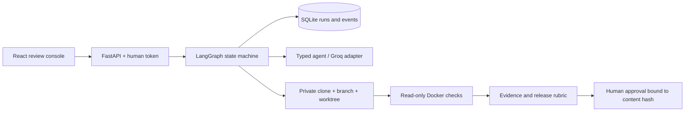

# Architecture and implementation milestones

CortexForge is a local modular monolith. React/TypeScript and TanStack Query
poll FastAPI; Python owns policy, Git, agents and execution. SQLite stores run
documents and append-only events through SQLAlchemy. LangGraph advances one
explicit state transition per node and writes separate SQLite checkpoints.
Application state is authoritative for side effects; graph checkpoints alone
are not a transaction boundary for Git or Docker.

## Contracts

`contracts.py`: Specification, Design, Implementation, Resolution, CreateRun,
Review. Unknown fields fail validation. Agent outputs propose actions; only
the workflow authorizes writes and starts fixed tool operations. QA, security
and release are deterministic specialist agents, deliberately avoiding model
calls where tooling gives stronger evidence.

`POST /api/runs`: requirement, repository, mode, optional demo fault. Returns
created run; background workflow execution is serialized per run by an OS lock.
`GET /api/runs`, `GET /api/runs/{id}`: state, events, checks and review evidence.
`POST .../clarify`, `POST .../resume`, `POST .../review`: explicit interventions.
`GET .../patch`: export only an approved, unchanged patch. `/api/health` exposes
availability without credentials. OpenAPI is available at `/docs`.

All run endpoints require `X-Review-Token`. Token is held in frontend memory,
never agent context or sandbox environment. Bind the backend to loopback only.

## Persistence

Runs store repository/base/branch, state, timestamps, version, retry counters,
pending operation, action hashes, structured outputs, baseline and candidate
checks, diff, rubric, risks and decision. Events store agent inputs/outputs,
usage, validation failures, transitions, tool results and human actions.
Optimistic version checks detect stale writes; process locks prevent concurrent
side effects. Schema creation is idempotent; migration tooling is a remaining
production-hardening task. SQLAlchemy supports a later PostgreSQL backend, but
PostgreSQL and distributed locks have not been verified.

## Milestones

1. Preserve authoritative statement and establish traceability.
2. Backend, typed agents and isolated repository vertical slice.
3. Docker evidence, bounded recovery, approval gates and restart tests.
4. Connected review interface.
5. Deterministic evaluation, verification and documentation.

No deployment, remote Git push or automatic merge capability exists.
